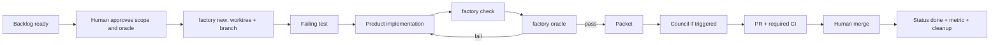

# Software Factories 101

This guide explains what a **software factory** is, why it exists, how this
repo's factory works, and how the skill is developed with it. No prior knowledge
of factories, orchestrators, or agents is required.

> This guide covers the core factory. Examples use the SWU integration
> (`legality-parity`, legacy `P0-2`) to make the flow concrete; the core ships
> `backlog.example.json` and an optional oracle hook instead of the SWU queue
> and cases. The permanent old-to-new mapping is in
> [`legacy-map.md`](legacy-map.md).

## 1. What is a software factory?

A **software factory** is a repeatable way to turn a request into verified
software. It is not a magic tool or a team of robots: it is a set of steps,
artifacts, and quality gates that make every change small, traceable, and
reviewable.

**Short definition:**

> A software factory is the process and tooling that turn a backlog item into a
> small, verified, mergeable PR with evidence and human gates.

**Analogy:** a factory does not "think" the product; it organizes the flow, the
parts, and quality control. The factory does not decide what is correct; it
organizes how correctness is demonstrated.

**It is not:**

- an LLM that writes code alone;
- a replacement for CI;
- a replacement for tests;
- a replacement for human judgment;
- a goal in itself.

**It is:**

- one backlog;
- one worktree per item;
- tests that fail before the implementation;
- a verification bundle;
- a domain oracle;
- a review packet;
- human gates for design and merge.

## 2. Why it exists

The bottleneck in agent-assisted development is not writing code. It is
**deciding what to build, verifying that it is correct, and reviewing it**.

A factory attacks that bottleneck with:

- **small batches**: one item, one question, one PR;
- **WIP=1**: one thing in progress at a time;
- **evidence**: check, oracle, packet;
- **gates**: green means green, and everything else blocks;
- **traceability**: every change has an item, a branch, and a metric.

## 3. The four layers

```text
+--------------------------------------------------------------+
| 1. HUMAN                                                     |
|    decides what, approves design, freezes the oracle, merges  |
+--------------------------------------------------------------+
| 2. FACTORY (control plane)                                   |
|    backlog, worktrees, checks, oracle runner, packets        |
+--------------------------------------------------------------+
| 3. SKILL (product)                                           |
|    domain/, infrastructure/, scripts/, tests/, schema         |
+--------------------------------------------------------------+
| 4. CI                                                        |
|    required checks on a clean clone                          |
+--------------------------------------------------------------+
```

The **factory** does not change a single deck verdict. If you delete
`factory/`, the skill still works exactly the same. That is the proof that it is
meta-work, not the product.

## 4. The flow, step by step



### 4.1 Intake

An item enters the backlog only when it is **ready**:

- one question;
- reproduction or evidence;
- acceptance test;
- an oracle row if the process label is domain sign-off (T3);
- a risk tier and a priority (`now`, `next`, `later`);
- a milestone and the current blocker, if any;
- not blocked.

```bash
python3 factory/factory.py list
python3 factory/factory.py show legality-parity
```

### 4.2 Start

```bash
python3 factory/factory.py new legality-parity --base origin/main
```

This creates:

- branch `factory/legality-parity`;
- worktree `/tmp/opencode/factory-worktrees/legality-parity`;
- a `data/` link for the real-data tests;
- the item marked as `doing`.

### 4.3 Design and oracle

- **quick review (T0/T1):** the acceptance test is enough.
- **council + differential tests (T2):** a short design and a test plan.
- **domain sign-off (T3):** a human freezes the expected values in
  `factory/oracle_cases/legality.json` (change `frozen_by` and add the exact
  source to `source`). The agent must not change the expected value to make the
  test pass.
- **human-led design (T4):** the factory only records the decision.

### 4.4 Red test

Before implementing, write the failing test:

```bash
cd /tmp/opencode/factory-worktrees/legality-parity
# edit skills/swu-review/tests/...
```

And confirm it is red:

```bash
python3 <control>/factory/factory.py check --worktree /tmp/opencode/factory-worktrees/legality-parity
python3 <control>/factory/factory.py oracle --worktree /tmp/opencode/factory-worktrees/legality-parity
```

If everything is already green, you have not written the right test.

### 4.5 Implementation

Inside the worktree, change **only the product**:

```text
skills/swu-review/domain/...
skills/swu-review/infrastructure/...
skills/swu-review/scripts/...
skills/swu-review/tests/...
```

Do not mix `factory/` changes into this PR. If you need a new tool, that is a
separate item.

### 4.6 Verification

```bash
python3 <control>/factory/factory.py check --worktree /tmp/opencode/factory-worktrees/legality-parity
python3 <control>/factory/factory.py oracle --worktree /tmp/opencode/factory-worktrees/legality-parity
```

- `check` = mechanical gates: tests, data-guard, ruff, mypy, links.
- `oracle` = domain gates: both CLIs against the expected values.
- **Both must be green to merge.** A green `check` with a red `oracle` blocks.
- If the change touches data, run the live Poggle case; the local `check` does
  not do it.

### 4.7 Packet

```bash
python3 <control>/factory/factory.py packet legality-parity \
  --worktree /tmp/opencode/factory-worktrees/legality-parity \
  --out /tmp/opencode/legality-parity-packet.md
```

The packet contains:

- scope and acceptance;
- check table;
- failure output;
- `git status` and diff stat;
- human gates;
- council triggers.

It is the PR body or the evidence for the reviewer.

### 4.8 Council

Only when triggered:

- council + differential tests, domain sign-off, or human-led design;
- legality, rules, schema, cross-cutting, or scope;
- red oracle.

Lenses: architect, operator, quality/factual risk, product/scope. Output:
consensus, disagreements, findings, recommendation. The human decides; the
council is advisory.

### 4.9 PR, CI, and merge

```bash
cd /tmp/opencode/factory-worktrees/legality-parity
git add skills/swu-review
git commit -m "fix(legality): share one Deck model across both CLIs"
git push -u origin factory/legality-parity
gh pr create --base main --head factory/legality-parity \
  --title "fix(legality): unify validate_deck and swu_analyze" \
  --body-file /tmp/opencode/p0-2-packet.md
```

- Required CI: `test`, `ruff`, `mypy`, `local-links`.
- Human review.
- Human merge; **no auto-merge** for council, domain-sign-off or human-led work.

### 4.10 Close and learn

After the merge:

```bash
git worktree remove /tmp/opencode/factory-worktrees/legality-parity
git branch -d factory/legality-parity
```

- Mark the item `done` in the backlog (manual today; the next increment would be
  a `done` command).
- Add one metrics line:

```text
2026-11-26 | legality-parity | domain sign-off | 2d | 25min | yes | 1 | 0 | ...
```

- If a defect escaped, create a new item and add the missing case to the
  oracle. Do not rewrite the expected value to hide it.

## 5. The quality gates

```text
1. Unit tests       -> the code does what it says, branch by branch
2. Local check      -> tests + lint + types + links + data-guard
3. Oracle           -> domain truth + parity between CLIs
4. CI               -> all of the above on a clean clone
5. Human            -> design, domain, merge
```

### Why green CI is not enough

`main` has 84 green tests and `legality-parity` (legacy P0-2) is still open:
`validate_deck` and `swu_analyze` return different answers. No isolated unit
test sees that divergence unless you wrote the case. The oracle sees it because
it runs both full paths and compares them with the domain expectation.

## 6. Risk and human gates

| Process label | Tier (internal) | Examples |
|---|---|---|
| quick review | T0 / T1 | docs, typos, tests, tooling |
| council + differential tests | T2 | engine behaviour |
| domain sign-off | T3 | rules, legality, data |
| human-led design | T4 | scope, architecture |

`data_touch: true` adds the data guard and the live case to any tier.

Humans approve the design and the merge. Agents implement, run checks and
assemble evidence. **Agents never merge.** There is no separate autonomy scale
in this spike.

## 7. The domain oracle

### What is an oracle

In testing, an **oracle** is the part that decides what the correct result is.
If the test is `assert result == expected`, the oracle is how we know that
`expected` is correct.

A **domain oracle** is the external source that says what is correct according
to SWU rules:

- `docs/rules.md`;
- `docs/metrics.md`;
- an independent manual calculation;
- a second implementation (differential testing);
- a mathematical invariant.

It is not the current code. If the expected value comes from the code, the
oracle is a snapshot of current behaviour, bugs included.

### Unit test vs oracle

| | Unit test | Oracle |
|---|---|---|
| Scope | one function or module | both CLIs end to end |
| Input | synthetic, mocks | adversarial fixtures |
| Expected | code behaviour/spec | SWU rules, frozen by a human |
| Catches | branches, local errors | CLI divergence, missing rules |
| If it fails | the code broke | the domain contract broke |

### Example row

```json
{
  "id": "leader-count-2",
  "description": "A leader entry with count 2 is illegal in Premier.",
  "mutation": { "type": "set_leader_count", "value": 2 },
  "expected": {
    "validate.valid": false,
    "analyze.legality.ok": false
  },
  "source": "docs/rules.md: exactly one leader"
}
```

### Synthetic vs live

- **PR gate:** synthetic catalogue and deck, offline, deterministic.
- **Live job:** real catalogue, weekly/manual, advisory; catches drift.

The `legality-parity` (legacy P0-2) cases are structural (leader count, slot
type, sideboard, `secondleader`), so they do not need real cards. A synthetic catalogue can
exercise the same rules.

### Data licensing

The repo does not redistribute card texts, images, or database dumps
([`docs/data-sources.md`](../../docs/data-sources.md)). Committed fixtures with
real names/stats are a trademark/copyright/database-rights risk. Therefore:

- PR gate with synthetic data;
- live job with real data, local cache, never committed;
- user decklists local or anonymized.

This is a risk assessment, not legal advice.

## 8. Metrics

One line per item:

```text
date | item | risk | lead_time | review_minutes | ci_first_pass | rework_commits | escaped_defects | cost
```

Why:

- **lead time**: how long an item takes from ready to merge;
- **review minutes**: how much human time it consumes;
- **ci first pass**: whether the PR arrives green or needs cycles;
- **rework**: commits after the first review;
- **escaped defects**: bugs that reach `main`;
- **cost**: tokens and CI minutes.

Without metrics, the factory is an act of faith.

## 9. Common mistakes

| Mistake | Why it is wrong | What to do |
|---|---|---|
| Building a platform before a product | It becomes the next meta-project | One small loop, one pilot |
| 100% coverage/MSI as the goal | It rewards trivial tests and exclusions | Diff coverage + ratchet + MSI on critical modules |
| The agent writes the expected values | It turns the bug into the spec | Human-frozen oracle |
| Auto-merge | Domain truth is not deterministic | Human merge for council, domain and human-led work |
| Council on every change | Review fatigue | Council by trigger |
| Mixing factory and product in one PR | No one knows what changed behaviour | One PR, one question |
| Real card data in fixtures | Legal risk | Synthetic in PR; live in the job |
| Green check with a red oracle | The check knows nothing about domain truth | Block the merge |

## 10. FAQ

**Is the factory the same as CI?**
No. CI is one of the gates. The factory also includes the backlog, worktree,
oracle, and packet.

**Is it the same as tests?**
No. Unit tests prove the code; the oracle proves the domain verdict.

**Is it an AI orchestrator?**
Not in this spike. It makes no LLM calls. Agents may run the flow, but the
factory is the process and the tooling.

**Could it be a separate project?**
Yes, later. First the loop must work in this repo; then, if there is a second
consumer, extract the generic part with a `.factory.toml`. The oracle cases stay
in the product repo.

**What is a spike?**
A small, time-boxed, usually throwaway implementation for learning. It is not
production. This `factory/` is a spike.

**Why WIP=1?**
Because the limit is human review, not generation. One item at a time reduces
context switching and makes the bottleneck visible.

**Why worktrees?**
So every item has a clean, isolated checkout without mixing changes or
dependencies.

**Why branch protection?**
Because a check that is not required is only a notification. `main` is already
protected; the oracle is not a required check yet.

## 11. Where to start

From the control worktree:

```bash
python3 factory/factory.py list
python3 factory/factory.py show example-path-config
python3 factory/factory.py check
python3 factory/factory.py packet example-path-config --no-check
# The oracle requires the project integration:
# python3 factory/factory.py oracle
```

Files to read:

- [`../README.md`](../README.md) — the factory contract;
- [`../backlog.example.json`](../backlog.example.json) — the core example queue;
- [`../factory.py`](../factory.py) — the CLI;
- [`templates/pr.md`](templates/pr.md) — the PR packet.

The SWU integration adds `factory/backlog.json`, `factory/oracle.py` and
`factory/oracle_cases/legality.json`. The core does not ship them.

## 12. Spike status

- The core is PR #10 (draft) on `spike/factory-core`; the SWU integration is on
  `spike/swu-integration`.
- `main` is protected, but the oracle is not a required check.
- The core ships an example backlog; the SWU integration ships the real queue.
- The core has 22 tooling tests and an 8-check verification bundle.
- The SWU integration oracle is red for `legality-parity` (legacy P0-2); that
  is the expected result.
- The expected values are **proposals** (`frozen_by` awaiting human review).
- The vocabulary is plain: `priority` is `now`/`next`/`later`, `risk` is an
  internal tier with a process label, and `milestone` uses product names. The
  old values are in [`legacy-map.md`](legacy-map.md).
- The CLI is about 500 lines; the council recommended about 100 LOC for the
  production version.
- The next step is not a workflow: it is a **synthetic fixture** to make the
  oracle PR-safe, then connect it to CI in advisory mode.
